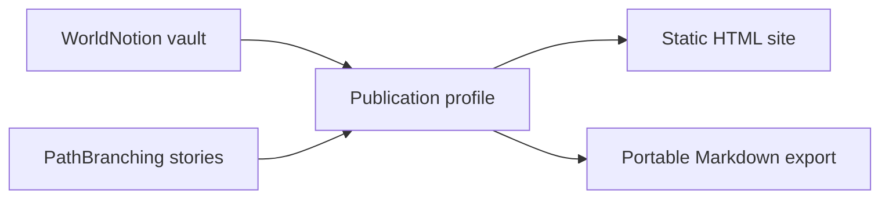

<p align="center">
  
</p>

<h1 align="center">Everend Compendium</h1>
<p align="center">
  Free, open-source publisher for shareable world encyclopedias and stories.<br />
  Build a read-only site from WorldNotion canon and PathBranching stories.
</p>

<p align="center">
  <a href="README.es.md">Español</a> · <a href="https://github.com/SoleipDreams/everend-forge-compendium/releases/latest">Download free</a> · <a href="https://website-everend-forge.pages.dev/">Explore the integrated Suite</a>
</p>

<p align="center">
  <a href="https://github.com/SoleipDreams/everend-forge-compendium/actions/workflows/ci.yml"></a>
  <a href="https://github.com/SoleipDreams/everend-forge-compendium/releases/latest"></a>
  <a href="LICENSE"></a>
  
</p>

<p align="center">Compendium is free to use on its own. The paid Suite is a separate integrated product; buying it does not change this app's open-source rights.</p>

---

Everend Compendium turns a WorldNotion vault and PathBranching's saved stories into a public static reading site. Canon Markdown remains the source of truth; the Compendium never writes during builds.



## Product direction

Compendium is the reading, consultation, and publication surface of Everend Forge. Its product milestones are **1.0 Wiki integral**, **2.0 Role editions**, and **3.0 Editorial assembly**; these are separate from the shared Forge 0.5 milestone and this package's version. See [docs/PRODUCT_DIRECTION.md](docs/PRODUCT_DIRECTION.md) for formats, boundaries and the development mockup.

## Use

```sh
npm install
npm run init -- /path/to/universe
npx tsx cli/cli.ts build /path/to/universe --out=dist
npx tsx cli/cli.ts package /path/to/universe --profile=public-demo --out=compendium-export.zip
npm run site:dev -- /path/to/universe
npx tsx cli/cli.ts markdown /path/to/universe --out=wiki-export
```

The preferred configuration is `.everend/.compendium/settings.json`. Existing vaults may keep using `.everend/compendium.yaml`; it is read as a legacy fallback and is never migrated or deleted automatically. The settings file controls the site title, visual theme, navigation order, and default statuses. Publication profiles live at `.everend/.compendium/publications/<profile-id>.json` and combine status rules with direct includes/excludes. `Preview` is the exportable projection; `All` is available only for local inspection. The reader projects PathBranching story, sequence, event, text, description, canon references, and safe narrative choices. A choice contains only its visible label and destination. Conditional routes are diagnosed and omitted; conditions, variables, consequences, and graph state remain private authoring/runtime data.

Useful publication commands:

```sh
npx tsx cli/cli.ts dev /path/to/universe --mode=all
npx tsx cli/cli.ts preview /path/to/universe --profile=public-demo
npx tsx cli/cli.ts dev /path/to/universe --mode=preview --profile=public-demo
npx tsx cli/cli.ts build /path/to/universe --profile=public-demo --out=dist
npx tsx cli/cli.ts package /path/to/universe --profile=public-demo --out=compendium-export.zip
```

`build` and `package` always use `Preview`; they reject `--mode=all`. Every Preview build writes `publication-manifest.json` beside the generated pages. The package is a standalone static site and contains only assets referenced by that publication.

`dist/` is ordinary static HTML and can be hosted on GitHub Pages, Cloudflare Pages, Netlify, or any static host. `export:markdown` produces a portable Markdown bundle and manifest for other wiki tools.

## Desktop reader

`npm run tauri:dev` opens the Tauri reader. Alongside the reading and story views, it offers an interactive relationship graph, a chronology, and an atlas.

The chronology is opt-in: add `date: "Year 1024"` or `start:` / `end:` to an entity's frontmatter. Entries without a date remain valid canon pages and simply do not appear in the timeline.

Maps are opt-in too. Create a published entity with `type: Map` and embed its image in the Markdown body. Pin an entity with `map: <map-id>`, `mapX: <0-100>`, and `mapY: <0-100>` in its frontmatter. These extra fields are additive and remain compatible with the v0.1 vault format.

## Everend Forge Suite compatibility

Compendium remains free and standalone, and it is also mounted as the reading workspace in the commercial Everend Forge Suite. Both modes open the same local universe folder. Compendium keeps the reader contract: it projects canon and selected narrative material without taking ownership of the source Markdown or PathBranching authoring data.

## Development

```sh
npm run typecheck
npm run lint
npm run format:check
npm test
```

The synthetic fixture under `tests/fixtures/vault` is also the GitHub Pages demo source.

## License

Code is licensed under either MIT or Apache-2.0; documentation is CC BY 4.0. Preserve required legal notices when redistributing. See [license scope](LICENSE), [MIT](LICENSE-MIT), [Apache-2.0](LICENSE-APACHE), [CC BY 4.0](LICENSE-CC-BY-4.0), and the separate [brand policy](TRADEMARKS.md).

## Support

If Everend Forge is useful to you, you can support its development on [Ko-fi](https://ko-fi.com/heinzdbv).
